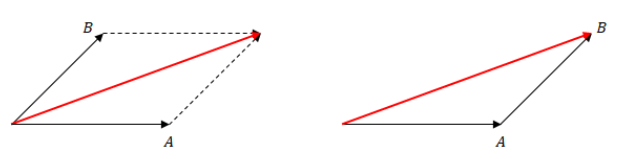
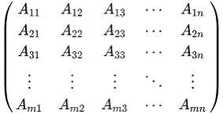

## 들어가며
컴퓨터 관련 전공으로써 수학을 엄밀히 증명해가며 서술하기 보다는 도구로써 사용하기에 그에 맞게 간단히 정리해 작성할 예정입니다.

사용한 교재는 [[프리드버그 선형대수학](https://product.kyobobook.co.kr/detail/S000001743767)] 입니다. 
수학과 전공서로도 쓰이는 이 책을 고른 이유는 한글번역판으로 서술이 잘 되어있고 다름이 아닌 저희 학교 공학선형대수학 교재가 매우 형편없었기 때문입니다. 실제로 저 수업에서 얻어간게 행렬곱 계산을 하며 다져진 계산능력밖에 기억이 안납니다..

꼭 알지 않아도 되는 부분은 시간이 나면 심화과정느낌으로 따로 정리해 보겠습니다.

## 벡터 (vector)

벡터는 **크기와 방향**을 모두 가진 물리량을 의미한다. 즉 크기와 방향만 고려하면 되므로 벡터가 어디에 위치했는지와 무관하게 크기와 방향이 같으면 동일한 벡터로 생각한다.

\
 
\
벡터의 합은 합성벡터로 설명할 수 있다. 흔히 평행사변형 법칙 (parallelogram law)를 통해 나타낼 수 있다.

> **벡터 합의 평행사변형 법칙** | 시점이 $P$로 일치하는 두 벡터 $x, y$의 합은 점 $P$에서 시작하는 벡터이고, 이는 $x$와 $y$를 이웃한 변으로 하는 평생사변형의 대각선으로 나타낸다.

비슷하게 스칼라 곱은 벡터에 스칼라 배를 해주는 것으로 벡터의 방향을 바꾸지 않고 크기만 스칼라 배 해준다. 물론 음수가 곱해지면 벡터의 방향이 $180^\circ$ 반대가 된다.

벡터를 **성분**으로 표시하면 (ex $\mathbf a = (a1, a2), \mathbf b = (b1, b2)$) 합과 곱은 다음과 같이 나타낼 수 있다.

- $\mathbf a + \mathbf b = ((a1 + b1), (a2 + b2))$
- $ c \mathbf a = (c*a1, c*a2)$

시점이 원점 $O$이고 종점이 $A, B$인 두 벡터를 각각 $u,v$라 하자. 그리고 시점이 $A$이고 종점이 $B$인 벡터를 $w$라 하자.\
$w = v - u$ 이다.\
\
두 점 $A,B$를 지나는 **직선의 방정식**은 다음과 같다
> $x = u + tw = u + t(v-u)$ \
(단, $t$는 임의의 실수이고 $x$는 직선 위 임의의 점)

여기서 쉽게 $u$가 A를 지나고 $w$가 A로 부터 B 방향을 나타낸다 라고 보면 쉽다. 즉 A를 지나고 B방향을 나타내는 모든 점들이다. 그게 곧 두 점을 지나는 직선이 된다는 것을 직관적으로 알 수 있다.\

마찬가지로 **평면의 방정식**도 나타낼 수 있다.\
시점이  점$A$이고 종점이 점$B,C$인 벡터를 각각 $u,v$라 하자. 세 점 $A,B,C$로 이루어진 평면 위 임의의 점 $S$는 $A$를 시점으로 하고 $su + tv (S벡터)$인 벡터 $x$의 종점이다.

> $x = A + su + tv$ \
(단, $s, t$는 임의의 실수이고 $x$는 평면 위 임의의 점)

## 벡터공간 (vetor space)

**벡터공간 또는 선형공간 (linear space)** $\mathbf V$ 는 다음 8가지 조건을 만족하는 두 연산, 합과 스칼라 곱을 가지는 집합이다.

> 1. 모든 $x, y \in \mathbf V$에 대하여 $x + y = y + x$이다.
>2. 모든 $x, y, z \in \mathbf V$에 대하여 $(x + y) + z = x + (y + z)$이다.
>3. 모든 $x\in \mathbf V$에 대하여 $x + 0 = x$인 $0\in \mathbf V$이 존재한다.
>4. 각 $x\in \mathbf V$마다 $x + y = 0$인 $y\in \mathbf V$가 존재한다.
>5. 각 $x\in \mathbf V$에 대하여 $1x = x$이다.
>6. 모든 $a,b\in F$와 모든 $x \in \mathbf V$에 대하여 $(ab)x = a(bx)$이다. 
>7. 모든 $a\in F$와 모든 $x ,y \in \mathbf V$에 대하여 $a(x + y) = ax + ay$이다.
>8. 모든 $a,b\in F$와 모든 $x \in \mathbf V$에 대하여 $(a + b)x = ax + bx$이다.

1,2 는 **덧셈의 교환/결합 법칙**, 3은 **항등원**, 4는 **합의 역원**, 5는 **곱의 항등원**, 6은 **곱의 결합법칙**, 7,8은 **분배법칙**을 의미한다.

체 $F$의 원소는 **스칼라**, 벡터공간 $\mathbf V$의 원소는 **벡터**라 한다.

\
**행렬**은 위와 같이 표현 가능하다.

가로를 **행(row)**, 세로를 **열(column)** 이라 한다.\
아랫첨자를 이용하여 성분을 $i행 j열$ 성분을 다음과 같이 나타낸다. $A_{ij}$ \
$i = j$ 인 성분을 **대각성분**이라 하고 모든 성분이 **0**인 행렬을 **영행렬**이라 하여 $O$로 표시하고 **행의 개수와 열의 개수가 같은 행렬**을 **정사각행렬**이라 한다.

>**벡터 합의 소거법칙**\
$x, y, z \in \mathbf V$ 이고 $x + z = y + z$ 일 때, $x = y$이다.

위 정리의 따름정리는 다음과 같다.

> 따름정리 1 | 벡터공간의 3번 규칙을 만족하는 벡터 $0$는 유일하다.\
따름정리 2 | 벡터공간의 4번 규칙을 만족하는 벡터 $y$는 유일하다.

{$0$}은 체 $F$ 위 **점공간**이라 한다.

## 부분공간 (subspace)

> **정의**\
$F$-벡터공간 $\mathbf V$의 부분집합 $\mathbf W$를 생각하자. 이 부분집합 $\mathbf W$가 $\mathbf V$에서 정의한 합과 스칼라 곱을 가진 $F$-벡터공간일 때, $\mathbf V$의 부분공간이라 한다.

모든 벡터공간 $\mathbf V$에 대하여 $\mathbf V$와 {$0$}은 부분공간이다. 특히 {$0$}은 **점공간인 부분공긴**이라 한다.

어떤 부분집합이 부분공간인지 확인하기 위해 벡터고간의 8가지 정의를 모두 화긴 할 필요가 없다. 아래 4가지만 확인하면 된다.

부분집합 $\mathbf W$가 $\mathbf V$의 부분공간이기 위한 필요충분조건은 다음 4가지 성질을 만족하는 것이다.

> 성질 1 : 모든 $ x \in \mathbf W, y \in \mathbf W$에 대하여 $x+y \in \mathbf W$이다 ($\mathbf W$는 덧셈에 대하여 닫혀있다).\
성질 2 : 모든 $c \in F$와 모든 $x \in \mathbf W$에 대하여 $cx \in \mathbf W$이다 ($\mathbf W$는 스칼라 곱에 대하여 닫혀있다).\
성질 3 : $\mathbf W$는 영벡터를 포함한다.\
성질 4 : $\mathbf W$에 속한 모든 벡터의 덧셈에 대한 역벡터는 $\mathbf W$의 원소이다.

다음 정리에 따르면 $\mathbf W$의 영벡터와 $\mathbf V$의 영벡터는 반드시 같고 위 성질이 만족하는 이유는 $\mathbf W$도 **벡터공간**이기 때문이다.

$m \times n$ 행렬 $A$의 **전치행렬(transpose matrix)** $A^t$는 $A$의 행과 열을 바꾸어 얻은 $n \times m$ 행렬이다.\
 즉, $(A^t)_{ij} = A_{ji}$이다.

**대칭행렬(symmetric matrix)** 은 $A^t = A$인 행렬이다. 대칭행렬은 바느시 정사각행렬이어야 한다.

$\mathbf M_{n \times n}(F)$의 모든 대칭행렬을 원소로 하는 집합 $\mathbf W$는 부분공간이다.

$m \times n$ 행렬 $A$는 대각성분 아래의 모든 성분이 0이면 **상삼각행렬 또는 위삼각행렬 (upper triangular matrix)** 라 한다.

대각성분을 제외한 모든 성분이 0인 정사각행렬을 **대각행렬(diagonal matrix)** 라 한다.

정사각행렬 $M$의 **대각합(trace)** 은 모든 대각성분의 합이고, $tr(M)$으로 표기한다.
대각합 또한 선형성을 가진다 ($tr(aA + bB) = atr(A) + btr(B)$)

> 벡터공간 $\mathbf V$의 부분공간들을 생각하자. 이 부분공간들의 임의의 교집합은 $\mathbf V$의 부분공간이다.

> 벡터공간 $\mathbf V$와 부분공간 $\mathbf W_1, \mathbf W_2$에 대하여 $\mathbf W_1 \cap W_2 = \lbrace0\rbrace$이고 $\mathbf W_1 + \mathbf W_2 = \mathbf V$이면 $\mathbf V$는 $\mathbf W_1$ 와 $\mathbf W_2$의 **직합(direct sum)** 이라 하고 $\mathbf V = \mathbf W_1 \oplus \mathbf W_2$라 표기한다.

즉 직합은 두 공간이 {0}빼고는 겹치는 부분이 없다.

> $M^t = -M$인 행렬 $M$을 **skew-symmetric matrix(반대칭행렬)** 이라 한다.

$F$-벡터공간 $\mathbf V$와 부분공간 $\mathbf W$를 생각하자. 임의의 $v \in \mathbf V$에 대하여 다음 집합을 $v$를 포함하는 $\mathbf W$의 **coset(잉여류)** 이라 한다.
- {$v$} + $\mathbf W$ = {$v + w : w \in \mathbf W$}